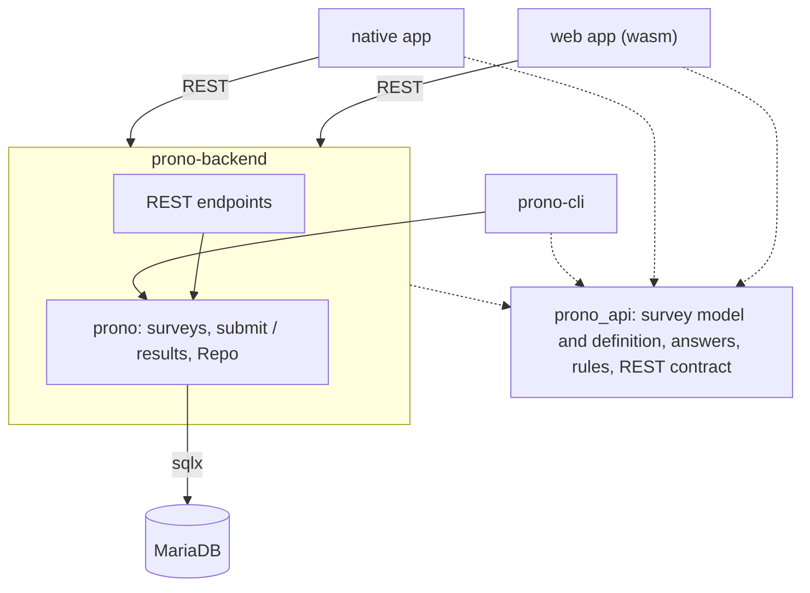

# Prono

[](https://deps.rs/repo/github/jaques-sam/prono)
[](https://github.com/jaques-sam/prono/actions?workflow=CI)

- [Prono](#prono)
  - [Summary](#summary)
  - [Architecture](#architecture)
    - [Adding a questionnaire](#adding-a-questionnaire)
  - [Contents](#contents)


## Summary

This repository is a combination of applications that interact to

  - conduct surveys,
  - collect them in a database
  - and visualize the results.


## Architecture



| Crate | Role |
| --- | --- |
| `api` (`prono_api`) | The model every binary shares: `Survey` and how it is defined (`Survey::from_json`), `Answer`, the validation rules and the REST contract. Compiles to wasm. `api/surveys/*.json` are example definitions, not part of any binary. |
| `prono` | Server-side core: the use cases (`upload_survey`, `submit`, `results`), the `Repo` trait with its MySQL and in-memory implementations, and the database config. |
| `backend` | `actix-web` REST server around `prono`. |
| `app` | egui app for desktop and web. Both talk to the backend over REST; the UI only draws a small state machine (`app/src/state.rs`). |
| `cli` | Admin tool on top of `prono`. |

There is one definition of each survey type (in `prono_api`), and the rules
live there too, so the app checks a submission with exactly the code the
backend uses to accept it.

> The diagram in [`docs/architecture.drawio.png`](docs/architecture.drawio.png) predates this layout.


### Adding a questionnaire

Surveys live in the database, not in the binaries: the backend serves them to
the apps, so a new one needs no redeploy. Write a definition and upload it
(it replaces the survey with the same `survey_id`):

```sh
cargo run --bin prono-cli -- surveys upload my_survey.json
```

```json
{
    "survey_id": 3,
    "description": "My survey",
    "link": "https://example.com",
    "access": "pass_phrase",
    "questions": [
        { "question": "When will it happen?", "answer_type": "prediction_date" },
        { "question": "Why?", "answer_type": "text" },
        { "question": "Which?", "answer_type": "poll", "possible_answers": ["A", "B"] }
    ]
}
```

- `access` is required, so that nobody fills in a survey unasked: `pass_phrase` (set it with
  `prono-cli access pass-phrase`) or `name_list` (fill it with `prono-cli access allow`). Until a pass phrase is set,
  the survey stays closed.
- `link` is optional; `possible_answers` is for `poll` questions only.

A question's id is derived from its text and answer type, and stored answers
reference that id: editing a question's text starts it from scratch.


## Contents

This repository contains the following applications:

- [Prono App](app/README.md)
- [Prono Backend](backend/README.md)
- [Prono CLI](cli/README.md)


