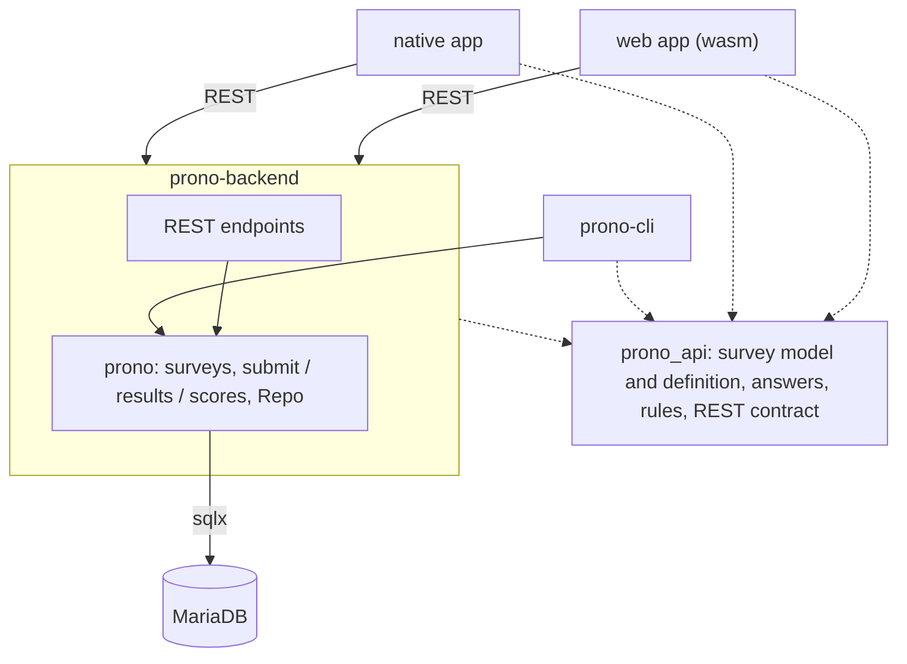

# Prono

[](https://deps.rs/repo/github/jaques-sam/prono)
[](https://github.com/jaques-sam/prono/actions?workflow=CI)

- [Prono](#prono)
  - [Summary](#summary)
  - [Architecture](#architecture)
    - [Adding a questionnaire](#adding-a-questionnaire)
  - [Contents](#contents)


## Summary

This repository is a combination of applications that interact to

  - conduct surveys,
  - collect them in a database
  - and visualize the results.


## Architecture



| Crate | Role |
| --- | --- |
| `api` (`prono_api`) | The model every binary shares: `Survey` and how it is defined (`Survey::from_json`), `Answer`, the validation rules and the REST contract. Compiles to wasm. `api/surveys/*.json` are example definitions, not part of any binary. |
| `prono` | Server-side core: the use cases (`upload_survey`, `submit`, `results`, `scores`), the `Repo` trait with its MySQL and in-memory implementations, and the database config. |
| `backend` | `actix-web` REST server around `prono`. |
| `app` | egui app for desktop and web. Both talk to the backend over REST; the UI only draws a small state machine (`app/src/state.rs`). |
| `cli` | Admin tool on top of `prono`: a menu to navigate, or commands for scripts. |

There is one definition of each survey type (in `prono_api`), and the rules
live there too, so the app checks a submission with exactly the code the
backend uses to accept it.

> The diagram in [`docs/architecture.drawio.png`](docs/architecture.drawio.png) predates this layout.


### Adding a questionnaire

Surveys live in the database, not in the binaries: the backend serves them to
the apps, so a new one needs no redeploy. Write a definition and upload it
(it replaces the survey with the same `survey_id`):

```sh
cargo run --bin prono-cli -- surveys upload my_survey.json
```

```json
{
    "survey_id": 3,
    "title": "My survey",
    "description": "What the survey is about",
    "link": "https://example.com",
    "questions": [
        { "question": "When will it happen?", "answer_type": "prediction_date" },
        { "question": "Why?", "answer_type": "text" },
        { "question": "Which?", "answer_type": "poll", "possible_answers": ["A", "B"] },
        { "question": "Any allergies?", "answer_type": "poll", "possible_answers": ["No"], "other_label": "Yes, namely:" }
    ]
}
```

- **Pass phrase:** every survey needs one, so that nobody sees or fills in a survey unasked. It is not part of the
  definition (there is no `access` key): set it with `prono-cli surveys pass-phrase <survey id> <pass phrase>`. A
  participant enters one pass phrase in the app and gets every survey that has it, so surveys for the same group can
  share one. Until a survey has a pass phrase it stays closed.
- `name_list` is optional (default `false`). With `"name_list": true` only the participants on the survey's name list
  may answer it, on top of the pass phrase, which is always needed: put names on it with
  `prono-cli surveys names allow <survey id> <first name> <last name>` (names are matched ignoring case). A name that
  is not on the list is refused when the answers are submitted.
- `link` is optional; `possible_answers` is for `poll` questions only. So is `other_label`, the name of the free
  answer next to the options (default: `Other`), for questions where that does not fit.
- **Scores:** give every question a `correct_answer` (text or option for `text` and `poll`,
  `{"month": 7, "year": 2028}` for `prediction_date`) and the survey is scored: participants see a ranking of the
  correct answers after submitting. All questions need one, or none. The correct answers never leave the backend, so a
  prediction survey can be uploaded again with them once the events happened; the answers already given are kept.
  `prono-cli surveys scores <id>` shows the ranking.

- **Answers:** `prono-cli surveys answers <id>` prints a table of everybody's answers (a row per participant, a
  column per question); add `--user "First Last"` for the answers of one participant. The interactive menu
  (`prono-cli` without a command) offers both under Surveys.

A question's id is derived from its text and answer type, and stored answers
reference that id: editing a question's text starts it from scratch.


## Contents

This repository contains the following applications:

- [Prono App](app/README.md)
- [Prono Backend](backend/README.md)
- [Prono CLI](cli/README.md)


